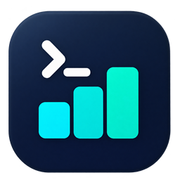
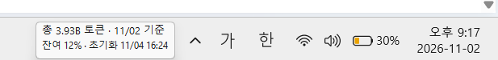

# Codex Usage Widget



A compact Windows desktop widget for monitoring Codex account usage. It follows the Windows theme and displays a two-line taskbar overlay with left, center, and right positioning. The details window has a fixed size.

## Screenshot



An actual screenshot with the overlay positioned on the right. Usage values and dates reflect the time of capture. The current application interface is in Korean; English descriptions below explain the controls.

## Getting started

1. Install the Codex app for Windows and sign in to your account.
2. Download [CodexUsage-Windows.zip](CodexUsage-Windows.zip) and extract it to a folder of your choice.
3. Run `CodexUsage.exe`.
4. To launch automatically at Windows sign-in, click the startup toggle at the top of the details window. Click it again to disable startup.

The startup toggle creates a shortcut in the current Windows user's Startup folder. Administrator privileges are not required. At sign-in, the widget shows the small overlay and keeps the details window hidden. Before moving the executable, disable startup, then enable it again from the new location. Disable startup before uninstalling the widget.

Each PC uses the Codex account signed in on that PC. You do not need to copy authentication files, another PC's `settings.json`, or task history.

## Updating an existing installation

1. Quit the running widget completely with **Ctrl+Shift+Q** from the details window, or use the exit item in the **···** menu.
2. Download the latest ZIP and replace `CodexUsage.exe` in your existing installation folder. Keep your local `settings.json`.
3. Run the updated executable. If the overlay is hidden, use the overlay toggle below the startup button or click a position button.
4. Turn automatic startup off and back on from the updated app to register its current path. Do this separately on each PC.

Do not copy settings or authentication files between PCs. Updating the download does not automatically update an existing installation or its Startup shortcut.

### Latest changes

- Chats tab: account-wide quota usage above a scrollable list of cumulative tokens per local chat.
- Responsive chat columns remove the unused space at higher display scales. A re-entry guard prevents resize events from recursively resizing columns.
- Always-visible overlay and three text-size controls, plus a new app icon embedded in the executable, window, and tray.
- Startup launches now show the overlay even when the previous session saved it as hidden. Normal manual launches preserve the saved choice.

- Releasing a drag no longer clamps the overlay to the desktop area above the taskbar.
- Dragging requires a mouse press that started on the widget; losing mouse capture cancels the drag state.
- The visible overlay periodically refreshes its topmost position to recover from being covered.

The build and 243 automated behavior checks passed. Tests include daily/chat panel geometry and font metrics simulated at 100%, 125%, 150%, and 200%, large token values, scrollable chat lists, resize handling, three overlay text sizes, startup preferences, and placement on smaller screens with negative monitor origins. The updated executable was installed and all three tabs were visually checked on one PC. These are simulated scale checks and a local UI check, not tests on four physical displays or other PCs. Launching the actual Startup shortcut was previously verified; Windows reboot/sign-in timing remains untested.

The details window retains its 400 × 316 logical client size and uses system DPI scaling. Chat columns adapt to their actual client width. The overlay uses explicit pixel text sizes selected by the user. Restart the widget after changing Windows display scaling. Live transitions between monitors with different DPI values have not been verified. See Microsoft's [automatic scaling documentation](https://learn.microsoft.com/en-us/dotnet/desktop/winforms/forms/autoscale) for background.

### If the overlay is missing

Check Task Manager for `CodexUsage.exe`. If it is running, check the overlay toggle below the startup button and reset its position. If it is not running, verify that automatic startup is enabled and the shortcut points to an existing executable. An `error.log` in the installation folder, when present, can help diagnose startup failures.

## Displayed information

- **Summary** (first tab): account-wide lifetime tokens, token aggregation date, remaining quota, and next reset time.
- **Daily** (second tab): usage for the latest seven dates reported by the server, plus the total for those displayed dates.
- **Chats** (third tab): account-wide quota usage percentage at the top, followed by each local chat's cumulative recorded tokens.

The chat list reads this PC's active and archived chat records, newest first. It includes more than fifteen chats, removes duplicate chat IDs, and excludes subagent records when identified. Scroll to see additional chats and hover over a truncated title to see its full text. Missing token records display “—”; a read failure retains the last value with an asterisk. The list is checked every five seconds; unchanged token files are cached.

The percentage in this tab is **account-wide quota usage**, not the selected chat's share of the account limit. Per-chat quota percentages cannot be calculated accurately from token counts. Chat token totals come from local records only; they do not include unavailable records on other PCs, and deleting local history can remove entries. Cumulative totals are used directly, so cached input tokens are not added a second time. Account-wide lifetime and daily usage may be delayed by server aggregation. Dates not yet reported are not treated as zero usage. Exact account-wide token usage since a quota reset is not currently displayed. When multiple standard Codex quota windows are available, the widget displays the remaining percentage for the longest window.

## Controls and refresh intervals

- **Click the overlay:** open the details window.
- **Drag the overlay:** move it manually.
- **Position buttons at the bottom:** choose left, center, or right, in that order. The selection is saved across restarts. Right positioning places the overlay before the clock and notification area.
- **Reset overlay position** in the **···** menu: return to the selected automatic position.
- **Overlay toggle below the startup button:** show or hide the small display. Windows startup launches turn it back on even if it was previously hidden.
- **Text size buttons above the position buttons:** Small (12/11 px), Medium (14/13 px), and Large (16/15 px), from left to right. The first and second numbers are the top and bottom lines. Changes apply immediately and are saved for the next launch. The details window keeps its original size.
- **Close the details window:** hide the window while the widget keeps running.
- **Ctrl+Shift+Q**, or the exit item in **···**: quit completely.
- **Quota refresh:** every 10 seconds.
- **Account token refresh:** every 60 seconds.
- **Local chats:** check for file changes every 5 seconds.

The overlay is a separate window placed over the taskbar. It does not modify the Windows clock or Explorer. If your Start button is on the left, use the right position button. Center and left positioning may overlap icons at those locations; you can also drag the overlay to adjust it. K, M, and B mean thousand, million, and billion tokens.

## Build from source

Uses .NET Framework 4.x and PowerShell on Windows 10/11. No additional packages are required.

```powershell
.\build.ps1
.\test.ps1
.\dist\CodexUsage.exe
```

If `CODEX_HOME` is set, the widget uses that folder. Otherwise, it uses `.codex` under the current user's profile. It looks for the Codex executable under `OpenAI/Codex/bin` in local application data, then falls back to `codex.exe` on PATH. If necessary, set `codexExe` in the generated `settings.json` to your installation path.

## Data handling

The widget reads account information through the signed-in Codex `app-server` and reads local chat records. It does not create model tasks. Settings, local chat history, and logs remain on your PC and are excluded from the repository and distribution package. Future Codex protocol changes may require compatibility updates.
