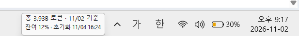

# Codex Usage Widget

Windows에서 Codex 계정 사용량을 확인하는 작은 데스크톱 표시기입니다. Windows 테마를 따르며 작업표시줄에 두 줄 상태바를 표시하며 왼쪽·중앙·오른쪽 위치를 선택할 수 있습니다. 상세 창 크기는 고정되어 있습니다.

## 실행 화면



작업표시줄 오른쪽에 배치한 실제 실행 화면입니다. 표시된 사용량과 날짜는 촬영 시점의 값입니다.

## 다른 PC에서 실행

1. Windows용 Codex 앱을 설치하고 본인 계정으로 로그인합니다.
2. 배포 ZIP을 내려받아 원하는 폴더에 압축을 풉니다.
3. `CodexUsage.exe`를 실행합니다.
4. 자동 실행을 원하면 상세 창 상단의 **자동 시작 꺼짐** 버튼을 누릅니다. 다시 누르면 등록을 해제합니다.

자동 시작은 현재 Windows 사용자의 시작프로그램 폴더에 바로가기를 만듭니다. 관리자 권한은 필요하지 않습니다. Windows 로그인 시 상세 창은 숨기고 작은 상태바를 표시합니다. 실행 파일을 옮길 때는 먼저 자동 시작을 끈 뒤 새 위치에서 다시 켜세요. 프로그램을 지우기 전에도 자동 시작을 꺼 주세요.

각 PC는 그 PC에 로그인된 Codex 계정을 사용합니다. 계정 인증 파일, 다른 PC의 `settings.json`, 작업 기록을 복사할 필요가 없습니다.

## 표시 항목

- **요약**: 계정 전체 누적 토큰, 집계 기준일, 잔여 한도, 다음 초기화 일시
- **일별**: 서버가 집계한 최근 7개 날짜의 사용량과 표시된 날짜 합계
- **이 작업**: 선택한 로컬 작업의 누적·입력·출력·캐시 토큰, 기록 확인 상태, 마지막 기록 시각

첫 실행에는 이 PC에서 최근 갱신된 작업 기록을 선택합니다. **··· → 작업 선택**에서 최근 작업 중 하나를 선택할 수 있으며, 선택한 작업은 자동 전환되지 않습니다. 현재 Codex에서 보고 있는 대화를 자동 인식하는 기능은 아닙니다.

캐시 토큰은 입력 토큰에 포함되며 전체 사용량에 다시 더하지 않습니다. 계정 전체 누적·일별 집계는 서버 반영이 늦을 수 있습니다. 아직 집계되지 않은 날짜를 0으로 추정하지 않습니다. 정확한 계정 전체 초기화 이후 토큰은 현재 표시하지 않습니다. 여러 기본 Codex 한도가 있으면 가장 긴 기간의 잔여율을 표시합니다.

## 조작과 갱신

- 작은 상태바 클릭: 상세 창 열기
- 작은 상태바 드래그: 위치 이동
- 상세 창 하단 **왼쪽 / 중앙 / 오른쪽**: 작은 상태바 위치 선택. 선택은 저장되어 재실행 후에도 유지됩니다. 오른쪽은 시계·알림 영역 앞에 배치합니다.
- **··· → 작은 표시 위치 맞춤**: 선택한 자동 배치 위치로 복귀
- **··· → 작은 상태바 켜기 / 끄기**: 작은 표시 전환
- 상세 창 닫기: 창만 숨기기
- **Ctrl+Shift+Q** 또는 **··· → 종료**: 완전히 종료
- 한도 조회: 10초 간격, 계정 토큰 조회: 60초 간격
- 선택 작업: 파일 변경을 2초마다 확인

상태바는 별도 창으로 겹쳐 표시됩니다. Windows 시계나 Explorer를 수정하지 않습니다. 왼쪽에 시작 버튼이 있는 PC에서는 오른쪽 버튼으로 위치를 조정할 수 있습니다. 중앙·왼쪽 배치는 해당 위치의 아이콘과 겹칠 수 있으며 드래그로도 조정할 수 있습니다. K/M/B 표시는 천/백만/십억 토큰입니다.

## 직접 빌드

Windows 10/11의 .NET Framework 4.x와 PowerShell을 사용합니다. 추가 패키지 설치는 필요하지 않습니다.

```powershell
.\build.ps1
.\test.ps1
.\dist\CodexUsage.exe
```

`CODEX_HOME`이 설정되어 있으면 해당 폴더를 사용합니다. 기본 데이터 폴더는 사용자 프로필 아래 `.codex`입니다. Codex 실행 파일은 로컬 앱 데이터의 `OpenAI/Codex/bin`에서 찾고, 찾지 못하면 PATH의 `codex.exe`를 사용합니다. 필요한 경우 실행 후 생성되는 `settings.json`의 `codexExe`를 설치 경로에 맞게 지정할 수 있습니다.

## 데이터 처리

로그인된 Codex의 `app-server` 계정 조회와 이 PC의 선택된 작업 기록만 읽습니다. 위젯이 모델 작업을 생성하지 않습니다. 앱 설정·선택한 작업 경로·로그는 이 PC에만 저장하며 저장소와 배포본에 포함하지 않습니다. Codex 프로토콜 변경에 따라 향후 호환성 수정이 필요할 수 있습니다.
